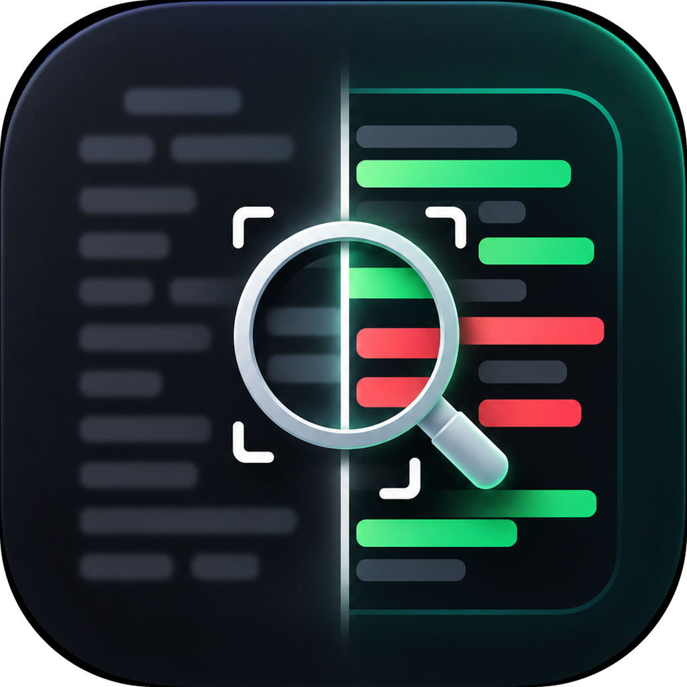
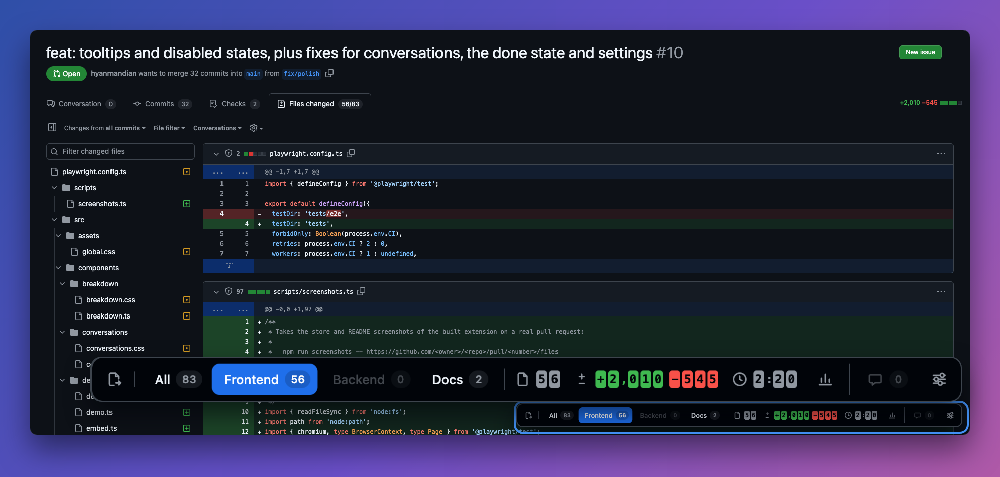

  
  <h1>Focus Diff</h1>
  
<strong>Review what matters.</strong> A browser extension and a desktop app for reviewing GitHub pull requests.

  

    
    
    
    
    
    
    
    
     
    
    
    
  

## The browser extension

### Why

Large pull requests mix the code you need to read with tests, stories, generated files and docs. Focus Diff adds a small bar to the **Files changed** page: pick a filter and only the matching files stay on screen. The file tree, the **Files changed** counter and the **+/−** totals follow along, so you see the real size of your review before you start.

### Features

- **Your own filters.** Each filter is a button with an _Include_ regex and an optional _Exclude_ regex, tested against the full file path. **All** is always there.
- **Everywhere or per repository.** Keep filters for every pull request, and add extra ones for `owner/name` or a whole `owner/*`.
- **Real numbers.** Files changed and the line totals show only what the filter keeps, and update as GitHub loads more files.
- **Combine filters.** Turn on as many as you like, like _Frontend + Docs_. Turn them all off and you're back on **All**.
- **See where the changes are.** The breakdown shows, per filter, how many files you've marked as viewed, the lines changed and the time left.
- **Review time left.** An estimate next to the line totals, from about 1,000 changed lines per hour, that drops as you mark files as viewed.
- **Conversations.** Step through review threads one by one. Each shows its file and line, and whether it's waiting on you, answered or resolved.
- **Keyboard friendly.** Arrow keys inside the bar, plus global shortcuts.
- **Your pull requests at a glance.** The toolbar button lists what's waiting for your review and your own open pull requests, what changed since you last looked first, each a click from its files. Turn on notifications to hear about new review requests, drafts that become ready, comments, approvals and requested changes, in the repositories you pick, each leaving out what you don't need, like drafts, bots, or pull requests you've already approved.
- **Review time.** Set aside time to review, like weekdays at 15:00 for half an hour. When it comes, Focus Diff picks the pull requests that fit, by how long each takes you, counting only the filters you pick, and tells you with a sound of its own. It learns your pace from the files you mark as viewed, so the estimates, the bar's too, follow you. Notifications can wait for it, and the toolbar icon counts the time down.
- **Made to share.** Copy your filters and send them to a teammate, who imports them in one step.
- **Looks at home.** Follows your GitHub theme, or make your own: pick the bar's colours in settings with a live preview, and share the theme with your team like filters. Checked against WCAG 2.1 AA, respects reduced motion, and speaks English and Portuguese.
- **Ready for more sites.** It works on GitHub. Everything that reads the page lives in one adapter per site, so others can follow: see [adding a site](CONTRIBUTING.md#adding-a-site).
- **Private.** No tracking, and nothing sent anywhere but GitHub. Your pull requests are read from github.com with the session already in your browser, only when you open the popup or turn notifications on. Filters stay in your browser profile. See the [privacy policy](PRIVACY.md).

### Getting started

Focus Diff starts empty, so your filters fit the way you review. Right after installing, a welcome page explains how it works and offers examples you can add with one click:

- **Split frontend and backend**, without tests and stories in the way.
- **Focus on one part of the codebase**, like the folder your team owns.
- **Read the code before the tests**, or only the tests.
- **Skip generated files**: lockfiles, snapshots, minified files and build output.
- **Check infrastructure changes**: CI, Docker, Terraform, Kubernetes and YAML.
- **Watch database changes**: migrations, SQL and schemas.
- **Review docs and copy**.

They're regular filters, so you can rename or tweak them later. The welcome page is always one click away from the settings.

### Keyboard shortcuts

| Shortcut                                     | Action              |
| -------------------------------------------- | ------------------- |
| <kbd>Alt</kbd> <kbd>Shift</kbd> <kbd>.</kbd> | Next filter         |
| <kbd>Alt</kbd> <kbd>Shift</kbd> <kbd>,</kbd> | Previous filter     |
| <kbd>Alt</kbd> <kbd>Shift</kbd> <kbd>0</kbd> | Show all files      |
| <kbd>Alt</kbd> <kbd>Shift</kbd> <kbd>J</kbd> | Next file to review |

On a Mac, <kbd>Alt</kbd> is <kbd>Option</kbd>. Change them at `chrome://extensions/shortcuts`, or in Firefox under `about:addons` → gear → _Manage Extension Shortcuts_.

### Install

**Chrome, Edge, Brave, Arc and other Chromium browsers:** add it from the [Chrome Web Store](https://chromewebstore.google.com/detail/focus-diff/nnocnopcbjipboglgbnmocfaplhlkfil).

**Firefox, Zen, LibreWolf and other browsers built on Firefox:** add it from [Firefox Add-ons](https://addons.mozilla.org/firefox/addon/focus-diff/).

Every [release](https://github.com/hyanmandian/focus-diff/releases/latest) also has builds you can load yourself:

- **Firefox and browsers built on it:** open `about:debugging#/runtime/this-firefox`, click **Load Temporary Add-on** and pick `focus-diff-firefox.zip`. It stays until Firefox restarts.
- **Safari (Mac with Xcode):** unzip `focus-diff-safari.zip`, run `xcrun safari-web-extension-converter focus-diff-safari --app-name "Focus Diff" --macos-only` and click **Run** in Xcode. In Safari, turn on **Settings › Advanced › Show features for web developers**, then **Develop › Allow Unsigned Extensions**, and enable Focus Diff in **Settings › Extensions**.
- **Chromium, without the store:** unzip `focus-diff-chromium.zip`, open `chrome://extensions` (or `edge://extensions`), turn on **Developer mode**, click **Load unpacked** and pick the unzipped folder. It won't update itself.

To build from source instead, run `npm install`, then `npm run build` (or `build:firefox`, `build:safari`) in `packages/extension`; the builds land in `packages/extension/.output/`.

## The desktop app: Mac, Windows and Linux

The desktop app lives in the menu bar (the system tray on Windows and Linux): your review queues at a glance, and every pull request opens in its own window to review it whole (overview, diff, conversations, checks, merging), without github.com. Download it from the [`desktop-latest` release](https://github.com/hyanmandian/focus-diff/releases/tag/desktop-latest) or [focus-diff.com](https://focus-diff.com/desktop.html); after that, the panel offers each new version with an Update button (the `.deb` and `.rpm` update by installing the new package).

- **Mac:** `Focus-Diff.dmg`, drag it to Applications and open it. It isn't signed with an Apple Developer ID yet, so the first time macOS stops it: open it, then go to **System Settings › Privacy & Security** and click **Open Anyway** (on macOS 14 and earlier, right-click it and choose **Open**). On a Mac without Open Anyway, such as one a company manages, install it from Terminal instead, with nothing to approve: `curl -fsSL https://focus-diff.com/install.sh | sh`.
- **Windows:** `Focus-Diff-Setup.exe`, installed for your user (no administrator needed). It isn't code-signed yet, so SmartScreen may warn you the first time: choose **More info › Run anyway**. Without Run anyway, install it from PowerShell instead: `irm https://focus-diff.com/install.ps1 | iex`.
- **Linux:** `Focus-Diff.AppImage` (make it executable and run it), or `Focus-Diff.deb` / `Focus-Diff.rpm`. The tray icon needs a desktop with tray support (KDE, or GNOME with the AppIndicator extension); its menu opens the panel.

## Contributing

Bug reports, ideas and pull requests are welcome. [CONTRIBUTING.md](CONTRIBUTING.md) explains how to run it locally, test it and cut a release. Please report security issues [privately](SECURITY.md).

## License

[MIT](LICENSE) © Hyan Mandian
